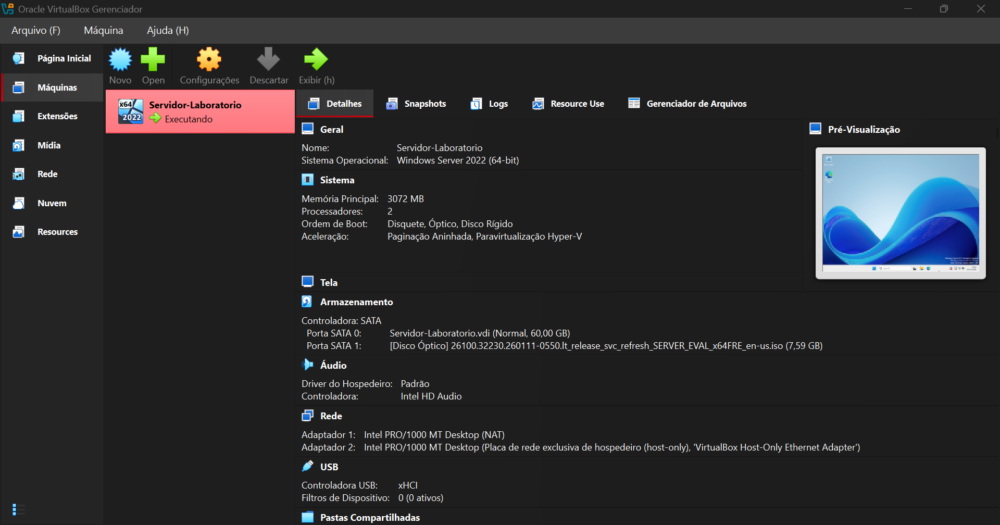
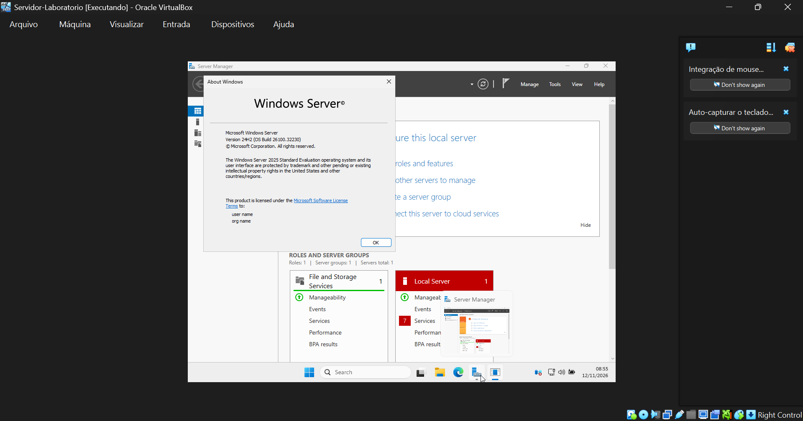
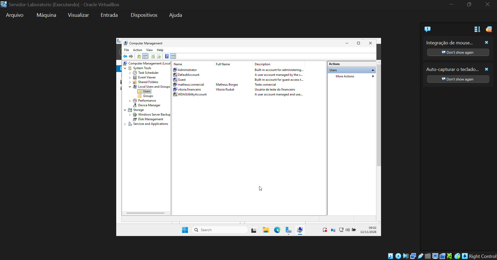
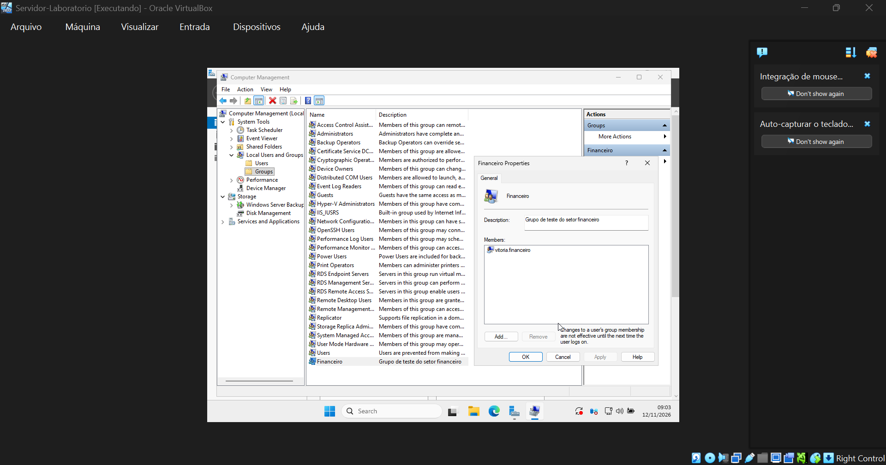
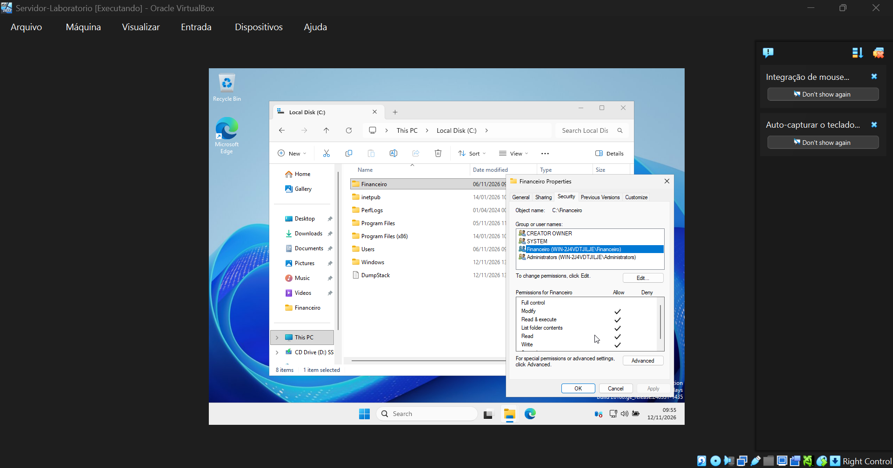
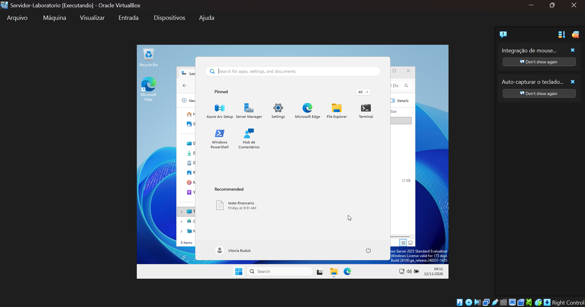
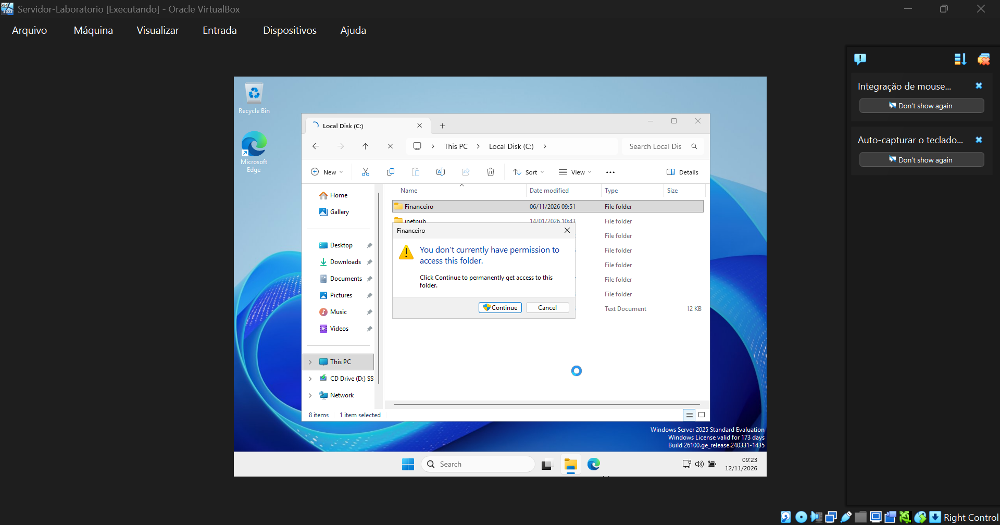

# Laboratório de Windows Server — Usuários e controle de acesso

## Sobre o projeto

Este projeto apresenta um laboratório virtual criado para praticar
a administração de usuários, grupos e permissões de acesso a pastas
no Windows Server.

O cenário simula dois setores de uma empresa: **Financeiro** e
**Comercial**. O objetivo é permitir que a usuária do Financeiro
acesse uma pasta do setor e verificar que o usuário do Comercial
não consiga abri-la.

## Objetivo

Praticar conceitos de infraestrutura de TI e controle de acesso,
organizando usuários em grupos e testando as permissões aplicadas
a uma pasta.

## Ambiente utilizado

| Recurso | Configuração |
|---|---|
| Virtualização | Oracle VirtualBox |
| Sistema operacional | Windows Server 2025 Standard Evaluation |
| Memória RAM da máquina virtual | 3 GB |
| Processadores virtuais | 2 |
| Disco virtual | 60 GB, com alocação dinâmica |

> No VirtualBox, o tipo de sistema foi identificado como Windows
> Server 2022. A versão instalada foi confirmada como Windows Server
> 2025 por meio do comando `winver`.

### Configuração da máquina virtual

### Versão do Windows Server

## Cenário do laboratório

Foram criadas duas contas locais para representar usuários de
setores diferentes:

| Conta | Setor |
|---|---|
| `vitoria.financeiro` | Financeiro |
| `matheus.comercial` | Comercial |

A conta do Financeiro foi adicionada ao grupo **Financeiro**.
O usuário do Comercial foi utilizado para verificar a restrição
de acesso à pasta.

### Usuários locais

### Grupo Financeiro

## Configuração das permissões

Foi criada a pasta **Financeiro** no servidor e configurado o
acesso para o grupo correspondente.

Na aba **Security**, o grupo Financeiro recebeu permissões como
leitura, gravação e modificação. A opção de controle total
**Full control** não foi marcada para o grupo.

A pasta também foi configurada para compartilhamento, com
permissões de leitura e alteração para o grupo Financeiro.

## Testes de acesso

Os testes abaixo foram realizados **localmente na máquina virtual**,
acessando a pasta pelo Windows Server.

| Teste | Resultado observado |
|---|---|
| Acesso com `vitoria.financeiro` | Acesso permitido à pasta Financeiro |
| Acesso com `matheus.comercial` | O Windows informou que o usuário não tinha permissão para acessar a pasta |

### Teste 1 — Usuária do Financeiro

Após entrar com a conta do Financeiro, foi possível abrir a pasta
e acessar um arquivo de teste.

### Teste 2 — Usuário do Comercial

Ao tentar abrir a pasta com a conta do Comercial, o Windows
apresentou uma mensagem informando que o usuário não tinha
permissão de acesso.

## Conhecimentos praticados

- Criação e gerenciamento de usuários locais.
- Criação de grupo para organizar usuários por setor.
- Configuração de permissões de segurança em pasta.
- Configuração de compartilhamento.
- Testes de acesso com contas diferentes.
- Registro de resultados para documentação técnica.

## Resultado

O laboratório permitiu praticar a organização de usuários e o
controle de acesso a uma pasta, diferenciando as permissões
conforme o setor de cada conta.

Como possibilidade de ampliação, o compartilhamento poderá ser
testado futuramente a partir de outro computador ou máquina virtual.
